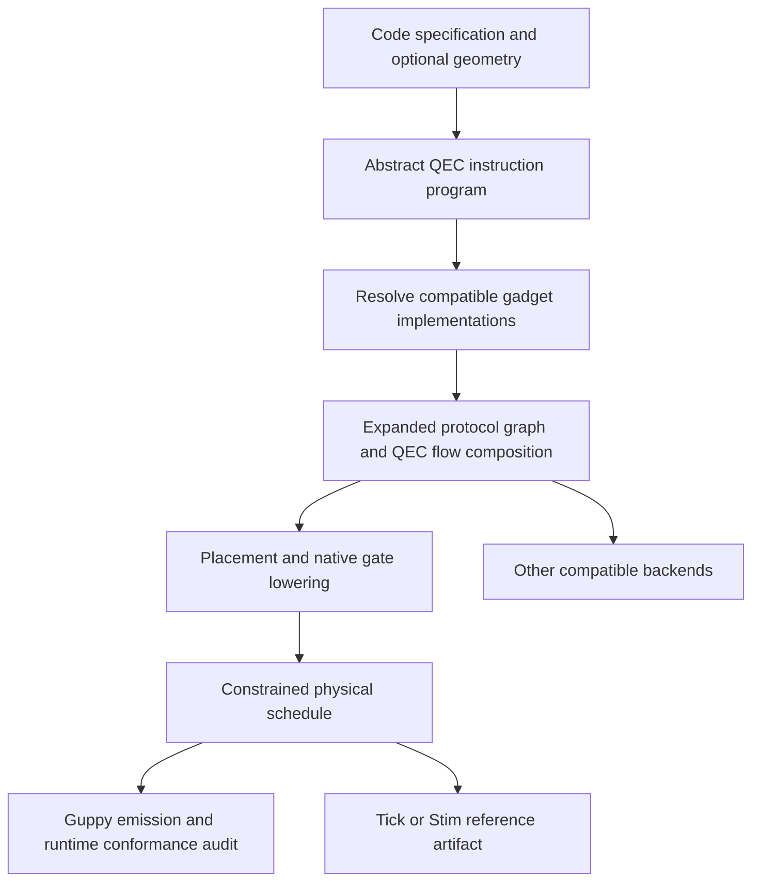

# QEC representations, implementation selection, and Guppy lowering

Status: architecture assessment plus an implemented static paper-code slice,
2026-11-02. The general instruction graph and migration remain proposals;
the concrete implementation status is recorded below.

## Recommendation

Represent codes, logical/QEC instructions, selected circuit implementations,
and scheduled physical operations separately. Let implementations expand into
inspectable bodies of simpler instructions, with Guppy as one supported output.
Keep detector and frame semantics attached to that expansion throughout.

Build on the existing `InstrProgram` proposal and the current surface gadgets,
SLR ownership machinery, check plans, and measurement audit machinery. Avoid
adding another code-family-specific generator for each paper or schedule.

The existing [overview](instr-program.md) explicitly excludes Guppy output
(lines 22–24, 250, 277), and the [rationale](instr-program-rationale.md) rejects
Guppy as a target. This assessment proposes changing that decision in response
to the current request. It does not silently modify those documents or claim
that their proposed Rust types have been implemented. Their Rust ownership and
thin Python authoring model can remain; a Python Guppy adapter need not own QEC
semantics. Guppy output remains outside the currently documented first MVP.

## Existing implementations

Paths below are relative to the repository. The inventory covers distinct
generator families in the current checkout, including experimental source and
the local color-code comparison work. Vendored snapshots, generated outputs,
tests, examples, and other worktrees are not counted as new implementations.

| Path / entry point | What exists | Reuse or limitation |
|---|---|---|
| `python/quantum-pecos/src/pecos/guppy_gen/surface.py:157` (`generate_guppy_source`) | Direct surface source generation, CX/SZZ choices, ancilla budgets, twirls, frame and trace metadata | Contains substantial synthesis and scheduling policy in the emitter; preserve its supported variants during migration. |
| `guppy_gen/color.py:39` | Direct 4.8.8 source generation from `ColorCode488` | Sequential bare-check extraction with two reused ancillas; geometry alone does not specify a fault-tolerant extraction circuit. |
| `guppy_gen/transversal.py:55` | Separate color-code source generator; public surface factories also exist | Color source repeats check/initialization machinery. Surface factories delegate to the surface protocol module. |
| `guppy_gen/gadget_render.py:89,271` | Physical gadget → reusable Guppy functions/modules | Closest existing common backend, but types, registers, returns, and roles are surface-specific. |
| `guppy_gen/protocol_render.py:31` | Composition of surface functions into H/CX/phase/teleportation experiments | Protocol recipes remain Python source templates, rather than one shared logical program consumed by every backend. |
| `guppy_gen/surface_teleportation.py:86,317` | Injection, heralding, and physical feed-forward | Exercises classical control and success contracts that a memory-only abstraction would miss. |
| `qec/surface/circuit_builder.py:1988,2940` | Guppy facade plus Stim/DAG/Tick renderers | `GuppyRenderer` intentionally builds a reusable module independently of its supplied op list; it is not a generic lossless circuit-to-Guppy renderer. |
| `slr/slr_converter.py:117`; `slr/ast/codegen/guppy.py:327` | SLR → AST → Guppy, also directly available through the AST registry | Reusable block functions, ownership checking, gate lowering, and restricted classical control. No authoritative QEC event/flow model or physical timing contract. |
| `slr/qeclib/{generic,steane,color488,surface}` | Composable check, flag, preparation, correction, and logical-gate blocks | Useful implementation library. The older SLR surface namespace is incomplete and distinct from `qec.surface`. |
| `output/color-code-alpha-comparison/src/color_code/{qeccColorCode,qeccColorCodeGuppy,guppy_utils}.py` | Abstract `QGate` recipes, bare/Bell-flag/superdense alternatives, digitized Guppy execution, detector/frame handling | Valuable alternate-implementation precedent. The Guppy helper and wrapper files are byte-identical in the multipatch and memory-20-rounds copies. Local experimental material, not the packaged API. |
| `qeccs/default_qecc.py`; `qeccs/default_logical_instruction.py`; `circuit_converters/checks2circuit.py` | Older code/logical-instruction/check/compiler separation | Emits `QuantumCircuit`, not Guppy. Reuse the conceptual distinction without inheriting fixed data/ancilla-role assumptions. |
| `exp/zlup/src/codegen/slr.rs`; `exp/guppy-zlup` | Zluppy → serialized SLR; Guppy → Zlup bridge and validator | Adjacent language bridges, not additional QEC-aware Guppy emitters. |

Except for the first and experimental rows, abbreviated paths in this table
start under `python/quantum-pecos/src/pecos/`. Compilation adapters such as
`_compilation/guppy.py`, `programs.Guppy`, and HUGR importers consume Guppy;
they do not independently synthesize QEC circuits.

Existing semantic pieces are also worth retaining:

- `qec/generic/check.py:51` supplies arbitrary-Pauli stabilizer supports.
- `qec/surface/gadgets.py:37` supplies immutable gadget records containing
  physical steps and allocation, although not yet generic instruction contracts.
- `qec/surface/_check_plan.py:54` records versioned synthesis and scheduling
  choices. This is a useful precedent for reproducible implementation selection.
- `qec/surface/logical_circuit.py:1037` composes logical operations, check-frame
  transitions, and cross-boundary detectors for the surface family.
- `qec/dem_spec.py:47` and `guppy_gen/_certificate.py:14` connect named raw
  measurements to the audited DEM path. Generalize the identity contract rather
  than inventing a second incompatible record-index scheme.

## Proposed representation boundaries



These are validation stages; they need not be six unrelated graph classes.
Implementation bodies can reuse the proposed `InstrGraph` with progressively
lower-level dialects. Native lowering and scheduling may need to iterate;
their outputs and changed assumptions must remain explicit.

### Code specification

Store stable data/check/logical identities, signed Pauli supports, logical
pairs, and code parameters. Geometry, embedding, boundaries, and periodic
identifications are separate optional structure. CSS representations are
convenient adapters, not a requirement that every code has only pure X/Z checks.

Extraction ancillas and CNOT order belong to implementations. A code may have
several logical qubits. Claimed distance and verified distance evidence are
different fields; neither ideal stabilizer commutation nor a family parameter
proves circuit distance.

Code-element identity is also distinct from the physical carrier. Implementations
may replace the carrier of a data position with a fresh ancilla, or relabel live
carriers, while preserving the logical code block. Carry explicit input/output
resource bindings and a mapping epoch; do not make data/ancilla roles immutable
properties of physical qubits.

### Abstract gadgets and instructions

Declare preparation, extraction, logical gates, resource consumption, and
readout with typed input/output blocks and classical values. Include lifecycle,
ideal logical action, frame transfer, and success/heralding requirements.
Preparation, projection, and initialization-sign correction must be distinct
where the implementation requires them.

Calling syndrome extraction should not choose an ancilla layout or a gate
schedule. A reusable gadget can expand into other gadgets. A selected
implementation must match the whole bound call, not merely an instruction name.

### Selected implementations and protocol graph

An implementation supplies local resources, lifetimes, operation dependencies,
measurement events, signed input/output check and logical flow relations, and
constraints on valid schedules. Record its identity, version, parameters,
fingerprint, applicability, and validation evidence.

Keep raw measurement events separate from interpreted syndromes. Represent
check parities, flags, logical-sign changes, and frame updates as typed affine
binary expressions over event identities, including constant sign bits.
One ancilla result need not correspond to one check. One extraction phase may
have a different interpretation and successor phase from another.

Keep extraction phase, carrier mapping, and Pauli/Clifford frame as separate
state. Advancing through a complete phase period need not restore the original
physical carriers. Composition must use the actual outgoing bindings, including
at terminal readout and between logical gates.

A program composition pass connects these local flow relations and constructs
preparation, inter-round, cross-gadget, and terminal detectors and observables.
Implementations provide their local relations; Guppy printers do not derive
QEC semantics from array names or measurement order.

### Scheduling and target choices

Keep the following choices distinct, even when a provider bundles them:

| Choice | Example | Obligation |
|---|---|---|
| Extraction construction | Bare, flagged, Bell-flag, superdense | Implement the declared ideal instrument and identify its supported fault-tolerance claims. |
| Extraction order | Hook-aware touch order, alternating phases | Preserve the provider's required order, phase transition, and boundary rules. |
| Ancilla allocation / placement | Dedicated ancillas, shared pools, fixed local sites | Respect lifetimes, interactions, connectivity, and budget. |
| Native implementation | CX, CZ with Clifford frames, SZZ | Preserve signed operation/check/logical action and translate records/frames. |
| Carrier replacement / relabeling | SWAP-based leakage reduction, software permutation | Distinguish physical quantum operations from handle permutations; preserve carrier identity and measurement/reset history. |
| Packing / timing | Reference moments, ASAP, duration-aware | Respect all dependencies and QEC constraints; retain the timing assumptions needed by noise. |

These choices are not an unrestricted Cartesian product. A provider can require
a particular schedule family, placement, native convention, or phase sequence.
An arbitrary topological reorder can preserve ideal behavior while changing
fault propagation, idling, or circuit distance. Scheduling needs an explicit
conformance envelope and new validation when it leaves that envelope.

Use typed instruction-scoped implementation handles and scheduler policies,
as the existing design proposes. Explicit choices must not silently fall back.
Record choices and constraints in artifacts and cache fingerprints. Selection
by depth, qubits, or estimated logical error is a later policy over compatible
candidates, not a reason to weaken their contracts.

### Guppy backend

The backend consumes an already resolved representation and handles function
structure, ownership, qubit allocation/consumption, classical expressions,
result emission, and compiler/runtime integration. It should not choose the
code's check schedule or detector formulas.

Reuse SLR's Guppy machinery through a supported-subset adapter if it can carry
the required semantics. Current blockers must be addressed explicitly:

- SLR `MeasureOp` stores targets and mutable classical destinations, not stable
  semantic measurement IDs (`slr/ast/nodes.py:424`).
- SLR barriers become comments and parallel bodies become ordinary statements
  (`slr/ast/codegen/guppy.py:1313,1388`). Surface gadget `TICK` is dropped
  (`guppy_gen/gadget_render.py:193`). Neither supplies a physical timing guarantee.
- SLR scratch qubits are allocated inside callees. That does not guarantee
  reuse of a particular device site across calls.
- Guppy block lowering supports only part of the AST resource-effect vocabulary;
  while loops are rejected, and branch/loop ownership joins are constrained.

Separate functional Guppy export from schedule-conforming export. The latter
requires a supported barrier/timing/resource mechanism and inspection of the
lowered runtime trace. Reject unsupported guarantees rather than treating source
line order as physical moments. Track the full mapping:

```text
semantic measurement event -> emitted scalar result -> compiler/runtime MeasId
                          -> actual record position
```

For a first static implementation, unroll a bounded number of rounds and emit
direct scalar measurement tags. Add compact loops only when provenance and
runtime scheduling are certified. A measurement-layout certificate alone does
not certify timing, physical site assignment, or circuit distance.

## Papers as acceptance families

### Dense planar and toroidal 4.8.8 circuits

[Denser Planar Color Codes, arXiv:2609.21376v3](https://arxiv.org/abs/2609.21376v3)
is a useful stress test: shared ancillas, phase-dependent syndrome/frame maps,
alternating planar extraction, periodic boundaries, and distinct explanatory
CNOT and optimized native-CZ constructions. Start with planar distances 3 and
7, both bases and starting phases; then add the torus family. Do not extend the
planar schedule automatically to every odd distance.

The [author's bundle](https://zenodo.org/records/22820614) contains geometry,
schedule rules, instrument algebra, generators, reference circuits, and
reconstruction checks. Use it as an independent oracle. Its seven-family API
also offers later comparison targets; importing all of them is not required
for the first integration.

Archive and extracted sources are at
`/Users/ciaran.ryan-anderson/Repos/papers/2609.21376-denser-planar-color-codes/`.
The downloaded ZIP matched Zenodo's MD5, and `sha256.json` records downloaded
artifact hashes. Preserve source attribution and the release's `LICENSE` and
`NOTICE.md` when adapting code.

### Helios triangular 6.6.6 circuits

[Quantum error correction well below the color code threshold,
arXiv:2610.24077v1](https://arxiv.org/html/2610.24077v1) adds triangular 6.6.6
codes at distances 3, 5, and 7. Its memory experiment combines Bell-flag
preparation, SWAP-superdense extraction with a three-phase schedule, virtual
Pauli-frame feedback, and hardware leakage repump. Software relabeling implements
the SWAP on the target platform. The study also includes logical two-qubit
Clifford randomized benchmarking and comparisons of algorithmic and neural
decoders. Decoding in the reported experiments was offline, including streaming
latency studies. See Figure 1, the memory/Clifford experiment descriptions,
and Supplement B for circuit conventions.

The following are proposed architecture requirements inferred from this case:

1. **Explicit carrier transitions.** A gadget must return the physical-resource
   bindings of its outgoing code positions. Preserve which carrier was measured
   or reset and which remains live, even if the emitted source keeps the same
   data-array indices. An abstract relabel has no quantum-gate noise site; a
   physical SWAP has a different implementation and noise contract. Relabeling
   is allowed only when the selected backend can address the resulting operands.
2. **Phase-aware composition.** Parameterize the phase period per implementation;
   do not hard-code the two-phase convention of the 4.8.8 provider. Track phase
   progression across gadget calls and loops, together with the outgoing carrier
   map and check/logical frame. Only the phase counter is necessarily periodic.
3. **Preparation flags and signed states.** Distinguish initialization outcomes,
   flags, recurring check records, and terminal measurements. Flags remain
   available to decoding; they do not imply discarding a shot. Support all six
   signed Pauli eigenstates, with sign and Clifford-frame tracking through
   preparation and readout. Postselection, where requested, is a separate
   explicit acceptance policy.
4. **Leakage-aware hardware services.** Model repumping as a target operation or
   declared service with applicability, timing/overlap, and channel semantics.
   It cannot silently become ideal reset, a Pauli correction, or a universal
   zero-cost operation. State-carrier replacement and hardware repumping are
   independent choices. Keep leakage/transport/crosstalk simulation distinct
   from a declared Pauli approximation used for a decoder DEM.
5. **Protocols beyond memories.** Represent logical Clifford sequences, their
   inverse, and configurable syndrome-extraction cadence in the logical program.
   Include reproducible random-sequence identity and per-block event namespaces.
   Logical SWAP changes block bindings; it is distinct from intra-block carrier
   relabeling. Compiler optimization must not erase a benchmark workload merely
   because its complete ideal action is identity.
6. **Decoder input contracts.** Preserve stable check/flag identities, coordinates,
   rounds, phases, block IDs, and availability order for batch or streaming
   consumers. Decoder choice is separate from extraction implementation. Expose
   decoder outputs and latency explicitly before claiming closed-loop execution;
   an offline replay is not evidence of real-time feedback integration.

There is already a useful local candidate under
`output/color-code-alpha-comparison/src/color_code/`:

- `qeccColorCode.py:14` constructs the 6.6.6 family; lines 315–371 build
  SWAP-superdense face recipes and their three orderings.
- `qeccColorCodeGuppy.py:471` selects and advances extraction phase modulo three,
  rebuilds the surviving data register, and updates detector/logical references.
- `guppy_utils.py:246,328` implements the encoded SWAP instruction using
  Guppy `mem_swap`, which is relevant to the relabeling/physical-gate distinction.

This is a reuse candidate, not a verified reproduction of the new paper. Its
gate order, boundary cases, frame conventions, resource mappings, compiler
behavior, and noise treatment need independent checks against the paper.

The PDF, extracted LaTeX and figures are archived at
`/Users/ciaran.ryan-anderson/Repos/papers/2610.24077-color-code-threshold/`;
`provenance.json` records version-pinned URLs and SHA-256 hashes. The main source
is `latex/arXiv_v1.tex`. This arXiv archive contains manuscript/figure sources,
not an executable circuit bundle. No separately published circuit bundle was
identified in that manuscript; the local candidate's provenance remains to be
established before treating it as the paper's oracle.

### Acceptance matrix

| Case | Role in the architecture validation |
|---|---|
| Existing surface memory, dedicated and batched ancillas | Backward compatibility and alternate allocation through one instruction interface. |
| Dense 4.8.8 planar / torus implementations | Shared records, phase-dependent flow, native lowering, periodic geometry, multiple logicals. |
| 6.6.6 Bell-flag / superdense / SWAP-superdense implementations | Alternate constructions, carrier transitions, signed initialization, and phase-state composition. |
| Two-block Clifford protocols with configurable extraction cadence | Cross-block observables, logical frames, decoder interfaces, and workload preservation. |

For the 6.6.6 candidate, first validate ideal signed instruments and carrier
transitions over all three phases, including incomplete periods and readout
after each phase. Check refresh coverage using physical-carrier histories;
do not infer leakage removal from a permutation of logical labels. Then check
single-fault signatures, explicit leakage injection, and the selected reset or
repump channels. Treat hardware-performance reproduction as a separate task
requiring the corresponding calibration/noise and decoder configuration.

## Incremental implementation plan

1. **Resolve the design policy.** Add Guppy as a supported, capability-checked
   consumer in the instruction-program design. Keep the graph authoritative
   and code-independent. Do not expand the first Rust MVP into every backend.
2. **Establish shared contracts with existing surface memory.** Adapt code
   identity, one extraction implementation, event/flow composition, and a
   reference schedule. Reproduce the existing physical and detector artifacts.
3. **Exercise real alternatives.** Carry dedicated and batched ancilla surface
   implementations through the same instruction interface, then add planar
   4.8.8 and the 6.6.6 Bell-flag/SWAP-superdense cases above. Use the latter to
   validate changing carrier bindings before freezing the resource interface.
   Reject an unsupported code/implementation combination.
4. **Add the Guppy consumer.** Lower the same resolved program to Guppy and
   Tick/Stim. Check compiler ownership and runtime measurement provenance.
   Establish schedule-conforming export before noise-equivalence claims.
5. **Migrate callers gradually.** Keep public factories as adapters. Move
   color/transversal source duplication and surface protocol recipes onto the
   shared representation. Preserve SLR as a frontend and implementation source.
   Add adaptive/injection cases as capability extensions with explicit joins.
6. **Reproduce physical experiments.** Validate native lowering, full noise
   placement, and decoder configuration separately from ideal equivalence.

Acceptance checks should cover commutation/rank and logical pairs; signed
instrument equivalence; phase transitions; ancilla liveness; per-wire gate
order and required moments; measurement identity; ideal detector and observable
parities; and single-fault detector/logical signatures. Noiseless samples alone
cannot establish fault tolerance. Compare DEMs under identical physical noise
and record conventions, retaining the required hyperedges. Distance searches
and logical-error benchmarks are separate evidence with explicit tested ranges.

## Implemented static paper-code slice

The first usable slice is available through `pecos.qec.color.color_code_spec`,
`color_code_implementation`, and `color_memory`. It separates code/check algebra
(`CSSCodeSpec`), a selected phase-dependent extraction (`ColorCodeImplementation`
and `ExtractionCycle`), measurement flows (`CSSFlow`), complete experiments
(`ScheduledCircuit`), scheduling (`SchedulePolicy`), and backend export.
The generic Guppy emitter contains no color-code construction logic.

Implemented constructions are planar 4.8.8 CX and native-CZ, triangular 6.6.6
superdense and three-phase SWAP-superdense, and Bell-flag initialization for
the 6.6.6 memories. Native basis frames, carrier relabeling, raw measurement
identity, detector constraints, and logical parities survive composition.
Reference and ASAP-unitary schedules are independently selectable. Stim retains
the selected physical moments; Guppy has an explicitly functional timing
contract and integrates with the existing trace-audited DEM builder.

This is a concrete Python adapter, not another claim that the proposed Rust
instruction graph exists. Existing generators remain available. The next
architectural step is to adapt this tested construction/flow contract to the
general instruction representation and migrate existing producers; it must
preserve phase state, role bindings, event identity, and schedule capabilities.

See [the user guide](../docs/user-guide/paper-color-codes.md) and
[the executable example](../examples/python_examples/paper_color_memories.py)
for API usage, supported ranges, citations, and limitations. Source downloads
remain under `~/Repos/papers/`; selected unchanged Apache-2.0 source files have
their license, notice, provenance paths, and hashes alongside the vendored code.

Implementation verification on 2026-11-02:

- New paper-code/Guppy suites plus existing color geometry: **113 passed**.
  This includes 16 independent 4.8.8 reference fixtures, conditional 6.6.6
  instrument comparisons against ideal Pauli projections on entangled inputs,
  Bell-flag branches, both scheduling choices, Guppy execution, typed DEM
  integration, and invalid-input regressions. These tests are included in the
  existing Python CI discovery paths.
- The comparison example ran all four constructions for 32 shots each in
  reference Z memory and ASAP X memory, with zero ideal detector/logical flips.
  It also built noisy DEMs from all four actual Guppy traces. Generated artifacts
  are under `output/paper-color-memories/`.
- Ruff passed on the changed Python modules, tests, and example. The pinned
  vendored files are excluded from rewriting; their provenance hashes match.
- MkDocs built successfully to `/tmp/pecos-paper-color-docs`; it reported
  existing unresolved links in the Selene runtime guide, not in the new guide.
- A fresh `gpt-6.1-sol`, high-reasoning implementation reviewer independently
  exercised the implementation, including distance-5/7 SWAP Guppy execution
  in both bases and all phases. A cache-dependent invalid-float acceptance
  finding was fixed with a typed cache and regression test. Raw review evidence
  is retained locally under `output/qec-guppy-assessment/`.

This does not reproduce the papers' complete physical noise models, hardware
experiments, thresholds, or logical-error curves. Timing-conforming Guppy
lowering, periodic codes, logical gadgets, adaptive protocols, and matched
decoder benchmarks remain outside this slice. Earlier architecture/baseline
checks below are historical, not additional implementation test claims.

## Named authoring follow-up, 2026-11-02

The paper memories now use `GadgetProgram` rather than directly concatenating
indexed operations and shifted measurement masks. `Gadget` exposes named roles,
live input/output ports, named outcomes, physical basis conventions, and named
check/frame relations. Calls bind ports and scope outcomes; XOR expressions
compose detectors and logicals. Compilation alone assigns operation/event
indices and emits `ScheduledCircuit`.

`CSSCodeSpec` exposes named check and logical operators. Extraction phases can
be inspected as gadgets; `color_memory_program` exposes the complete authored
sequence before scheduling. `color_memory` remains a compatibility convenience
through the same path. An independent, hand-authored repeated-ZZ example shows
that new gadgets and bindings require no Guppy emitter changes.

Each operation retains its call/gadget/original-moment identity through
scheduling. Inspection provides named operands, reference carriers, predecessor
dependencies, placements, resource counts, event aliases, and detector
expressions. Generated Guppy comments carry those identities and aliases.
These source-level annotations do not establish a runtime timing/debug contract.

Validation: **129 tests passed** across named gadgets, paper circuits/Guppy,
and existing color geometry. Both standalone examples executed; the paper
example produced the same four noisy DEM line counts as before migration.
Ruff passed and MkDocs built successfully. A fresh-context `gpt-6.1-sol`, high
reviewer reported no blocking findings after 108 focused tests and an additional
independently authored Guppy experiment involving relabeling, frame conversion,
role reuse, affine parities, and both schedules. Review evidence remains local
at `output/qec-guppy-assessment/named-gadget-review.txt`.

Declared check flows and frame conventions remain semantic claims supplied by
the gadget author; structural validation does not prove quantum equivalence.
This step supports flat static composition, not hierarchical/adaptive protocols,
device connectivity solving, duration scheduling, or the proposed Rust graph.
See [the authoring guide](../docs/user-guide/named-qec-gadgets.md).

## Six-state and logical-Clifford extension

`ColorCliffordExperiment` now composes canonical 6.6.6 blocks through named
Bell-flag preparation, six signed Pauli states, extraction, transversal
H/S/S-dagger/X/Z/CX, and X/Y/Z logical readout. `ColorFrame` propagates named
check references and logical sign corrections between those operations;
each block retains its next extraction phase, while the generic compiler
retains carrier bindings. Existing X/Z reference factories are unchanged.

`color_state_memory_program` uses logical-zero projection followed by the
requested preparation Clifford, extraction, and inverse-preparation readout.
This yields a homogeneous failure parity even for negative states. Direct
protocol readout instead returns the signed logical measurement value.
Tests distinguish these contracts and verify state eigenvalues before any
inverse gate, exact signed Pauli conjugations, and interleaved encoded circuits
against independent ideal logical simulators. See the
[Clifford guide](../docs/user-guide/color-code-cliffords.md).

### Additional reference: superconducting color-code implementation

Include Lacroix et al., [arXiv:2412.14256v1](https://arxiv.org/html/2412.14256v1).
Its Clifford-dependent detector relations inform the current frame interface.
Its readout-line-compatible superdense transformation now has a separate
normalized ideal native-CZ memory implementation, described below. Injection/postselection and lattice
surgery motivate future success contracts and changing check sets. The generic superdense option remains distinct from this hardware construction.

The v1 PDF, HTML, and LaTeX (30 extracted files with hashes) are stored in
`~/Repos/papers/2412.14256-color-code-scaling-logic/`. The paper links a
[738.5 MB experimental dataset](https://zenodo.org/records/14238944). Its ZIP
central directory was inspected remotely (11,336 entries), and 16 ideal circuits,
their metadata, and the README were retrieved selectively using HTTP Range.
Entry sizes/CRC32 were verified and SHA-256 provenance retained; the full archive
was not downloaded. The implementation remains distinct from reproduction of
the paper's experiments.

## Initial assessment review and verification record

Target: HEAD `2a78bfc400c3124dbdf88062fec96f679cff191e` plus the pre-existing
working-tree changes visible on 2026-11-02. The checkout was already heavily
modified; it was inspected in place without changing production source.

Reviewers: primary Codex orchestrator (direct inspection) and one fresh-context
`gpt-6.1-sol`, high-reasoning reviewer (`slr_qec_review`) covering SLR, legacy
QECC, language bridges, and the existing design. No cross-family panel was
used; the separate assignment added coverage of a distinct compiler path.
The orchestrator checked the reported AST, barrier, facade, and design-policy
limitations against source. No contradiction remained. Recommendation:
proceed with the layered design; revise the existing no-Guppy policy. This is
not a correctness verdict on an implementation that does not yet exist.

Executed checks:

- Existing AST Guppy and SlrConverter Guppy tests: **19 passed** (independent
  reviewer). Command: `.venv/bin/python -B -m pytest -p no:cacheprovider
  python/quantum-pecos/tests/pecos/slr/ast_tests/test_ast_codegen_guppy.py
  python/quantum-pecos/tests/pecos/unit/test_slr_converter_guppy.py -q`.
- Author generator: **16 cases passed**, planar distances 3/7 × CNOT/native-CZ
  × X/Z × starting phase 0/1, each with three rounds. Each constructed an ideal
  DEM and sampled 32 shots with zero detector/observable flips. These are
  reference-generator checks, not a Guppy implementation or distance proof.
- Existing surface/gadget/check-plan/protocol tests: **191 passed, 1 deselected**
  in 116.94 seconds. Command: `.venv/bin/python -m pytest -q
  python/quantum-pecos/tests/qec/surface/test_gadget_parity.py
  python/quantum-pecos/tests/qec/surface/test_check_plan.py
  python/quantum-pecos/tests/guppy/test_surface_protocol_module.py
  -k 'not runtime and not noiseless' --disable-warnings --maxfail=2`.

Environment: Python 3.12 from `.venv`, Guppy 1.0.1, Stim 1.15.0,
quantum-pecos/pecos-rslib 0.11.0.dev0, Selene 0.3.0. Imports resolved to this
checkout's Python PECOS and rslib packages. The native extension was not rebuilt
or established to match all current Rust changes. The paper pins Stim 1.16.0;
these checks do not claim byte-for-byte reproduction of its published circuits.

The 2610.24077 addition was reviewed directly by the orchestrator against the
downloaded v1 manuscript and the local candidate source; no new panel was
needed for this bounded extension. The earlier executed checks apply to the
original assessment only. No new circuit implementation, paper-equivalence
test, leakage validation, or hardware benchmark was run for this addition.

## Paper fidelity before alternative schedules (2026-11-02)

The implementation priority is paper-defined circuits, independent verification,
and then controlled alternative schedules. A speculative SWAP-superdense-style
4.8.8 refresh construction is deferred. Shutty's shared square/octagon ancillas
and alternating check maps mean a new refresh circuit needs its own signed
instrument, carrier/frame-flow, detector, and fault-distance validation; it is
not established by appending SWAPs or by ideal memory sampling.

| Source | Implemented circuit scope | Remaining paper/reproduction work |
| --- | --- | --- |
| Shutty, arXiv:2609.21376v3 | Planar 4.8.8 geometry, twelve-layer CX and optimized native-CZ extraction, alternating phases, X/Z memories; four-logical periodic 488 CNOT/native-CZ memories; 40 ideal references and 18 released noisy SI1000 references; exact small d3/d4 bounds and d8/d12 witness upper bounds; native noisy TickCircuit execution; planar/periodic decoder coordinates; pinned-decoder validation and released statistics | Toric/666 comparisons; parallel inline sampling; larger-instance lower bounds and publication-precision logical-error benchmark reproduction |
| Lavasani et al., arXiv:2610.24077v1 | Canonical triangular 666 superdense and three-phase SWAP-superdense; Bell-flag projection; six Pauli memories; static transversal Clifford composition and propagated sign/check frames | Complete experimental protocols, randomized benchmarking, Helios timing/leakage/repump model, matched decoder/noise studies and published error curves |
| Lacroix et al., arXiv:2412.14256v1 | Released d3 west/east/north and d5 X/Z memory construction, normalized native-CZ boundary/recurring gadgets; original detector/logical parities | Original timing and repeated-reset noise locations; nonzero sweep configurations; randomized-benchmarking protocol, magic injection/postselection, lattice-surgery teleportation, device/noise/decoder reproduction |

The table includes the later coordinate, SI1000, and decoder-validation extensions
below. Full published performance curves remain outstanding.

### Lacroix memory construction

`lacroix_memory_program` composes named preparation, first extraction, repeated
middle extraction, final extraction, and readout. Ten CZ layers per extraction
and merged X boundary Hadamards come directly from the released circuits.
`lacroix_memory` compiles this authoring form for either schedule policy and
all three backends. JSON tables require no runtime Stim/NumPy dependency.

The normalized ideal construction sets sweeps to zero, makes implicit initial
preparations explicit, removes spectator-only and duplicate fresh-zero resets,
removes empty timing slots, and separates final readout. Consequently it does
not reproduce the original timing or noise model. Reference scheduling preserves
these normalized authored moments. At least two rounds are required.

Source fixtures are unchanged files with archive paths and SHA-256 hashes from
[Google Quantum AI's release](https://doi.org/10.5281/zenodo.14238944).
The extraction script uses only three-round files; the five-round files test
composition independently. All 16 references match per-wire physical gates,
measurement ordinals, every detector parity, and accumulated logical parity.
Additional tests cover two/four/seven rounds, both schedules, all patch/basis
pairs through Guppy, a Guppy trace DEM, and native TickCircuit definitions.

### Shared lower-level backends

`ScheduledCircuit.to_tick_circuit()` joins `guppy_program()`/`guppy_source()` and
`to_stim()` as a consumer of the same selected schedule. Native ticks retain
explicit moments, reference carriers, and canonical event IDs. Pure RELABEL
changes carriers without a physical gate/tick; explicit empty moments survive.
Parities resolve against actual native emission order. Named source operations,
relabel events, labels, citations, and event aliases remain in `qec_*` metadata.
Native TickCircuit supports the existing DEM pipeline. Guppy still provides a
functional contract; timing and site allocation must be audited from its trace.

At this stage native exports rejected empty and affine parities. The signed
parity extension below supersedes the affine restriction; empty-support native
DEM definitions remain rejected.
Opaque names beginning with `L` are escaped where native syntax would interpret
them as decoder IDs, with original names retained separately.

### Review evidence

Six-state/Clifford integration passed 239 tests before this extension. A fresh
independent scientific verifier checked signed logical Pauli identities and
6.6.6 instrument/frame flows; a separate implementation reviewer tested randomized
multiblock experiments. The latter found a scoped-label collision through colons
in block names, fixed with upfront validation and regression tests. Reports are
under `output/qec-guppy-assessment/color-clifford-*.txt`.

The native-backend reviewer found reserved observable-label parsing, misplaced
moment metadata, and empty-parity schema failures. All three were reproduced,
fixed, and covered by regressions. Physical carrier/moment/record checks passed
across all four existing extraction choices and both schedules. The Lacroix
reviewer independently verified all 16 files against the downloaded references,
recurring-round equality, X boundary gates, and 20-round ideal extrapolation
for all eight patch/basis combinations, with no blocking finding.

These are local checks using the existing native extension, not a native rebuild
or full-repository CI result. Ideal checks are not circuit-distance proofs,
leakage-model validation, or evidence of a better logical error rate.

Final focused validation for this extension: **348 tests passed in 86.55 s**
across `test_color_cliffords`, `test_color_clifford_memories`,
`test_named_gadgets`, `test_paper_color_codes`, `test_paper_color_memories`,
existing `test_color_geometry`, both `test_lacroix_memories` modules, and
`test_scheduled_tick_circuit`. Ruff and `git diff --check` passed. MkDocs built
successfully with existing unrelated Selene-runtime link warnings. The standalone
Lacroix example ran all eight patch/basis cases with 16 ideal Guppy shots each,
produced native noisy DEMs, and exported valid SVG previews plus Guppy/Stim and
resolved definitions. The TickCircuit review's targeted resolution recheck
passed 13 regressions and an independent metadata/label probe; no blocking
finding remains within either new review's scope.

## Periodic 4.8.8 CNOT construction (2026-11-02)

`periodic_488_code(d)` now exposes the author's distance-4m quotient, named face
checks, period vectors, and four canonical X/Z logical pairs. This uses a separate
`Periodic488CodeSpec`; the planar API's single logical support is not silently
repurposed. `periodic_488_implementation(code)` binds the twelve-CNOT-layer,
single-phase extraction, with named input/output face maps, eight logical-sign
maps, intrinsic constraints, ancilla coordinates, and allowed couplers.

`periodic_488_memory_program` constructs X/Z memories using the author release's
parity composition. Recurring calls reuse the named extraction gadget; fused
first/final variants retain preparation and readout overlapping disjoint ancilla
operations. Single-round memories have their own complete boundary contract.
The global color dependencies and intrinsic-constraint completion remain intact.
Four separately indexed observables reach Python evaluation, Stim, Guppy raw-event
specifications, TickCircuit definitions, and both noisy DEM pipelines.

Seven pure-Python/JSON files from the Apache-2.0 release's `_torus488_cnot`
package are vendored unchanged, with LICENSE, NOTICE, original paths, and hashes.
Independent external-source fixtures cover d=4/8/12 geometry and X/Z memories at
one/three rounds. Tests check every physical moment, raw measurement order,
face/logical parities, CSS ranks, canonical logical pairing, and allowed edges.
Independent Stim tests verify complete signed Choi correlations at d=4/8/12,
and all 44/140/300/524 named signed flows at d=4/8/12/16. Stim's signed `has_flow`
check uses randomized trials with false-positive probability at most 2^-256 in
the installed version; it is not described as an exact symbolic proof.
The detector-plus-observable span equals the number of determined measurements
for d=4/8 memories, including one-round and alternate-schedule cases. Guppy
execution covers d=4/8 × X/Z × both schedules. A single-round four-logical case
also exercises the audited Guppy-trace and native TickCircuit DEM pipelines.

One independent reviewer, `/root/review_periodic488`, verified all source hashes
and regenerated all 15 fixtures from the external author package, independently
checked signed flows, and reviewed the recurring-gadget reuse. It found no
blocking issue. Evidence is retained in
`output/qec-guppy-assessment/periodic488-review.txt`. This is a local review of
the working tree on HEAD `2a78bfc400c3124dbdf88062fec96f679cff191e`, not a review
of unrelated changes or a full CI/native rebuild.

### Native-CZ prerequisite audit (resolved by the following extension)

The source release's 25-moment periodic native-CZ memory is **not** implemented
by this CNOT factory. An independent reference-sample audit found seven X-memory
and ten Z-memory detector parities with raw noiseless value one at d=4, r=2;
all four accumulated logical reference parities are zero. Stim's detector
sampler implicitly compares with its reference sample, whereas the current
named-plan evaluator evaluates raw records and therefore needs explicit affine
constants. The present Stim/TickCircuit/DEM adapters reject affine constants.
Simply copying the detector record sets would make noiseless evaluations wrong.
Audit data: `output/qec-guppy-assessment/periodic-native-cz-sign-audit.json`.

The next implementation step is an explicit signed-parity contract across
backend evaluation and DEM/reference metadata, followed by the native-CZ
primitives and 25-moment construction. Decoder coordinates and matched SI1000
remain separate from ideal circuit equivalence. New SWAP-style 4.8.8 refresh
variants remain deferred until these paper baselines are verified. No new
circuit-distance, threshold, or better-schedule claim is made here.

Final local validation: **412 tests passed in 119.03 s** across the previous
nine-module focused suite plus `tests/qec/test_periodic488.py` and
`tests/guppy/test_periodic488_memories.py`. Ruff and `git diff --check` passed.
MkDocs built with only the existing unrelated Selene-runtime link warnings.
The periodic example ran d4/r3 X and Z memories with 16 Guppy shots each;
all four logical outcomes and all detector checks passed. Native DEMs contained
2051 lines per basis. Existing native extension used; no rebuild or full CI run.

## Explicit XOR constants and periodic native-CZ (2026-11-02)

Typed definitions now accept literal bits: `Detector("m0", "m1", 1)` and
`Observable(rec[-1], 1, id=0)`. Repeated ones cancel, zero is neutral, and other
integers fail. `constant=True`, `definition ^ 1`, and `1 ^ definition` are
alternative spellings. Named and indexed parity expressions also support XOR
with a bit. At least one measurement support remains necessary for typed/native
DEM definitions; constant-only native schemas are not silently accepted.

Constants are expression offsets, not guessed noiseless values or determinism
certificates. The scheduled evaluator and all audited `GuppyDemBuild.evaluate_*`
paths apply them. Serialized `parity_constant` entries are included in the schema
fingerprint, while error propagation depends only on measurement support because
constants cancel in fault differences. Existing `reference` metadata remains
separate and is not automatically XORed or inferred. Automatic output-based
inference still rejects affine constant-one outputs; explicit typed definitions
are the supported path for those expressions.

Native TickCircuit keeps its physical gates, ticks, and emitted records unchanged.
Its raw JSON detector/observable metadata retains constants. The existing native
`circuit_definitions()` returns supports only; `evaluate_tick_circuit` resolves
those positions and applies the constants. The common metadata reader preserves
native integer/`D<n>`/`L<n>` IDs, legacy ID aliases, and whitespace-empty schemas.
Stim export serializes offsets with one trailing `MPAD 1` synthetic record only
when needed; it adds no physical gate/tick. `evaluate_stim_record` validates and
removes that padding. Canonical physical measurement IDs/counts remain unchanged.
Stim detector sampling still reports deviations from its own reference sample,
which is not the same operation as evaluating an authored affine expression.

`periodic_488_implementation(code, gate_set="native-cz")` now uses the released
25-moment construction. Fourteen pure-Python/JSON files are vendored unchanged
from `_torus488`, with Apache-2.0 license, source paths, and hashes. Physical
`C_XYZ`, `C_ZYX`, and `SQRT_X` become native `F`, `Fdg`, and `SX`; Guppy lowers them
as the appropriate Clifford sequences. Basis-frame ports describe the stationary
data H frame. Native memories preserve exactly 25 moments per round, including
fused first/final boundaries and single-round cases.

A pure-Python linear solver composes signed cycle check/logical/constraint maps
with initialization, interround continuity, and terminal readout. It then derives
the constant for each author's chosen memory parity support. It does not infer
signs by sampling and does not depend on Stim at runtime. Twelve new external-
source reference fixtures cover d=4/8/12 × X/Z × one/three rounds. Tests compare
physical moments, supports, and raw reference signs independently. Framed signed
flow checks extend through d=16; Guppy runs d4/d8 under both schedules, and a
native runtime test directly exercises the F/Fdg/SX execution path. Both native
and audited Guppy DEMs retain all four logical IDs and raw signed evaluation.

Independent reviews: `/root/review_affine_parities` and
`/root/review_periodic_native_cz`, following the personal review skill. The affine
review found a slotted-dataclass cache error and legacy metadata compatibility
issues; each was reproduced, fixed, regression-tested, and rechecked. Native-CZ
review verified signed framed flows, complete deterministic constraints, exact
release schedules/supports, primitive conventions, and Guppy execution. Neither
review has a remaining blocking finding. Reports are retained in
`output/qec-guppy-assessment/affine-parity-review.txt` and
`output/qec-guppy-assessment/periodic-native-cz-review.txt`.

Remaining work includes matched SI1000/decoder-coordinate benchmarks, other
periodic comparison families, and the not-yet-covered paper protocols. New
4.8.8 refresh variants remain research alternatives requiring their own
instrument and circuit-fault validation. No hardware benchmark, circuit-distance
proof, or better-schedule result is claimed by this extension.

Final validation: the combined color-code, named-gadget, scheduled TickCircuit,
affine-parity, and Guppy integration suite passed **480 tests** in 197.09 seconds.
The broader Guppy DEM and measurement-reference compatibility suite passed
**432 tests**, with **7 expected failures**, in 165.81 seconds. Ruff and
`git diff --check` passed; MkDocs built successfully with existing unrelated
link warnings. The native-CZ example ran d=4, three rounds, both bases, 16 shots
each, with 75 ticks and four logicals; native DEM artifacts were generated.
Validation used the existing native extension, without a rebuild or full CI run.

## Detector coordinates through lowering (2026-11-02)

The next bounded paper-fidelity step preserves decoder annotation coordinates.
Before this change, periodic 4.8.8 detector 0 at d4/r1/X had author coordinates
`[2, 2, 0, 2]`, but `plan.to_stim()` exported an empty coordinate vector. The
coordinates were present only in the detector's display label. Forwarding them
also revealed that the native JSON DEM parser required exactly three numbers.

`GadgetProgram.detector(..., coords=(...))`, `GadgetFlow.coords`, and
`MeasurementParity.coords` now carry immutable finite vectors. Compilation,
rescheduling, and XOR constants preserve them. The selected schedule does not
reinterpret an authored round coordinate as a physical tick. Stim export,
Guppy `dem_spec()`, and native TickCircuit annotations receive the full vector.
The periodic factories preserve the public release's coordinate convention. CNOT
keeps four axes. Native-CZ also applies the final torus branch of the release's
`vendor/_coordinates.py::decoder_coordinates`: remove the color axis and replace
placeholder `(0, 0)` positions with centroids of distinct measured physical qubits.
This port has no runtime Stim dependency. The 24 external fixtures independently
check coordinates; native centroid comparisons account for six-significant-digit
rounding in serialized Stim reference text. The upstream coordinate source has
SHA-256 `fb4e85ca4b1971b5d4ac56b8242048c596cf3cf9c3c68185b04cbcdc25cb2ec1`.

Native parsed/model detector coordinates are now `Option<Vec<f64>>` rather than
`Option<[f64; 3]>`. The Rust `with_coords` method still accepts fixed arrays;
direct field assignments must use vectors. Circuit definitions, all DEM text
renderers, structured decoder models, mechanism exports, and the Python getter
preserve arbitrary dimensions. JSON omission and explicit `[]` remain distinct;
native zero-argument annotations retain their existing absent-coordinate meaning.

Geometry-dependent algorithms keep explicit contracts. The existing terminal
pairing metric uses the first three axes, pads missing axes with zero, and treats
empty/absent coordinates as unprovided. Additional color/basis labels do not
contribute to that metric. Both source slice conversion and automatic slice
layout reject vectors other than `(x, y, round)` before any projection. Full
four-axis slice composition is not introduced by this export extension.

Independent review used one fresh `gpt-6.1-sol` reviewer at high reasoning effort,
focused on downstream dimension assumptions and compatibility. It found no
blocking implementation issue and identified a misleading slice error message;
the message and regression tests were updated. The report is
`output/qec-guppy-assessment/detector-coordinate-review.txt`. Runtime verification
against the rebuilt native extension is recorded in the validation artifact.

Remaining paper work includes matched SI1000/decoder benchmarks, circuit-distance
validation, and the uncovered protocols/families in the coverage table. Coordinate
preservation alone does not establish a decoder configuration or error-rate result.

Final validation: **954 Python tests passed** across the integration, coordinate,
and compatibility selections, with seven expected failures; **941 Rust tests
passed**, with six ignored. The original integration run exposed the native-CZ
coordinate postprocessing gap after 428 passes; the complete affected 52-case
selection passed after correction. All 20 new coordinate cases passed on the
final rebuilt extension. Independent full-precision comparisons matched the
public author generator exactly for eight native-CZ and two CNOT cases.

The empty-coordinate regression also caught Stim's interpretation of literal
`DETECTOR()`/`detector()` as a single zero coordinate. Circuit and DEM text now
omit parentheses for empty coordinates, while structured metadata retains the
empty vector. Rust Clippy, Ruff, and whitespace checks passed. MkDocs built with
existing unrelated link warnings. The native-CZ d4/r3 example ran both bases,
16 Guppy shots each, and exported native DEMs with the final spatial coordinates
to `output/periodic-coordinate-memories`. Details and raw logs are retained in
`output/qec-guppy-assessment/detector-coordinate-validation.txt`. Native rslib
was rebuilt from this working tree in dev mode; full repository CI was not run.

## Matched scheduled SI1000 and physical fault bounds (2026-11-02)

`SI1000(p).apply(plan)` adds a separate, inspectable noise layer to a selected
native-CZ schedule. `NoiseChannel` identifies the physical moment, operation,
placement, targets, probability, and reason. The layer preserves all gates,
measurements, and ticks. It includes full-allocation idle noise, premeasurement
and postreset errors, and independent collapse-wait depolarization even on
concurrently active sites. Primitive single-qubit Cliffords retain their single
physical time step. Synthetic affine MPAD does not acquire noise. CNOT and free
RELABEL inputs fail rather than receive an implicit physical lowering.

The implementation follows the released `src/vendor/_triangle488/native.py`
SI1000 convention and simulation-methods paragraph of arXiv:2609.21376v3, with
source DOI 10.5281/zenodo.22820614 cited in code and documentation. Eighteen
unchanged `circuits/simulated/` files and original `distance/witnesses.json`
locators are pinned by SHA-256 under `tests/qec/fixtures/si1000`. Comparisons
retain per-wire gate/noise ordering inside every physical moment and the full
undecomposed DEM's supports and probabilities. Commuting instruction batching,
annotation placement, and the synthetic constant record are deliberately not
used as false physical differences. Planar decoder geometry is not yet exported.

`PauliFault` selects a nonidentity branch at one positive-probability location.
A two-qubit depolarizing branch counts once; selecting the same location twice
is forbidden. `verify_logical_fault` checks ideal determinism and propagates
only the selected faults as deterministic `*_ERROR(1)` instructions using Stim's
Pauli-frame simulator. Ideal X/Y/Z gates would instead be interpreted as part
of the reference and are not used for fault injection.

`fault_distance_bounds` combines that physical upper bound with optional
exhaustive exclusion through weight one, two, or three. It retains complete
hyperedges and all logical bits. Allowing mutually exclusive same-location
branches together is a relaxation, so successful exclusion is a sound lower
bound; failed exclusion is not presented as a physical counterexample. A pair
budget fails explicitly. Only matching lower/upper bounds receive `exact=True`.
These results describe the specific finite memory and physical fault convention.

Numerical review found and reproduced a false-exactness counterexample at
p=1e-20: direct DEM construction can round a real depolarizing branch away.
Support extraction now uses a fixed interior SI1000 rate (p=.001) with the same
Pauli branch family, independent of user weights. This is conservative even if
some user channels underflow. Witness selection separately checks actual branch
probability and rejects underflowed zero-rate branches. Regression tests include
the three-reset witness versus one-idle-fault counterexample and subnormal rates.

Validation: 18 noisy-circuit equivalences and 18 replayed witnesses, including
12 exact small cases (planar d3 at both bases/phases/rates, periodic d4 at both
bases/rates). The six d8/d12 cases retain only upper bounds of eight/twelve.
The new test module has 53 passing cases (52 in the complete run, followed by
the expanded witness-validation case and new nondeterminism case); 63 existing
named-gadget, TickCircuit, affine-parity, and native fault-distance tests passed.
Ruff and whitespace checks passed; MkDocs built with existing unrelated link
warnings. Executed examples produced [3,3], [4,4], and [1,8] bounds under
`output/si1000-planar-d3`, `output/si1000-periodic-d4`, and
`output/si1000-periodic-d8` respectively.

Two fresh independent gpt-6.1-sol/high reviewers covered distinct uncertainties.
The noise reviewer matched 1,200 generated schedules to the original decorator.
The fault reviewer compared 3,000 random support sets with independent subset
enumeration, replayed all 12 small author cases, and found/rechecked the numerical
bugs above. Both concluded no blocking findings after resolution. Reports and
validation artifacts are under `output/qec-guppy-assessment/`.

Current noisy export/replay/DEM-support analysis uses optional Stim (installed
1.15.0; the publication pins 1.16.0). Guppy and TickCircuit implementations remain
accessible as `noisy.ideal` and are explicitly ideal. Their runtime noise is not
silently replaced by this profile, and Guppy timing/allocation is not inferred
from the source schedule. Native execution/DEM support for these explicit
channels, matched decoder error-rate benchmarks, and larger-instance lower
bounds remain follow-up work. No full repository CI or new native rebuild was
performed for this Python-only extension.

## Native scheduled SI1000 execution and DEMs (2026-11-02)

`noisy.compile_native()` now prepares the explicit channel sequence for PECOS
native execution and analysis. It samples one mutually exclusive Pauli branch at
each physical channel, while native `SparseStab` executes gates and measurements.
The returned physical records retain canonical scheduled event order and authored
parity constants are applied by `plan.evaluate`. Python orchestrates the native
kernels; this is not a compiled batch runtime or a performance claim.

Native `DagFaultAnalyzer` propagates each channel's Pauli effects independently
of Stim. Identity markers locate channel boundaries only in the analysis DAG;
they do not change hardware gates, moments, or idle/wait rates. Measurement-node
identities are explicitly mapped back to scheduled record ordinals. Commutation
with Z at every preparation output and measurement input verifies the backward
stabilizer-flow constraints; nondeterministic ideal parities are rejected.

`native.detector_error_model()` uses the exact depolarizing-to-independent-Pauli
conversion `(1-2q)**(4**n/2) = 1 - p*4**n/(4**n-1)` and stable `log1p`/`expm1`
evaluation. Identical effects combine by independent XOR probability. The new
native `DetectorErrorModel.from_independent_mechanisms` constructor and
`independent_mechanisms()` accessor avoid text rounding and sampler-threshold
quantization. Declared dimensions, absent/empty/full coordinate vectors, and tiny
nonzero probabilities survive construction. The constructor accepts independent
Bernoulli mechanisms, not unconverted categorical branches.

`native.fault_effect(faults)` returns deviations from ideal parities, where affine
constants cancel. `native.replay_faults(faults)` executes those selected physical
faults and returns raw measurements. The aggregate DEM does not retain physical
channel exclusivity or physical witness weights. Existing bounded-distance
helpers still use their validated Stim oracle; native propagation/replay supplies
an independent check of their witnesses.

The updated `si1000_color_memories.py` example saves full-precision native DEM
mechanisms and native measurement/parity samples, alongside ideal Guppy/Tick
artifacts and the noisy Stim circuit. Both planar d3 and periodic d4 examples
replayed their published physical witness through native propagation and native
stabilizers, retained exact [3,3]/[4,4] bounds, and generated 64 noisy trajectories.

One fresh Sol/high independent review found no blocking defects: all 18 published
DEM support sets/probabilities agreed with Stim; 2,880 parity-determinism decisions,
4,587 physical branch effects, and 1,440 native trajectory checks also agreed.
Separate full joint-distribution enumeration checked categorical physical noise
against independent DEM mechanisms at zero, tiny, ordinary, and endpoint rates.
Review/provenance and local regression logs are under
`output/qec-guppy-assessment/native-si1000-*` (uncommitted artifacts).

Remaining scope: fused native batch execution of the explicit channel plan,
noise-bearing standalone TickCircuit export, Guppy timing/allocation audits,
decoder/logical-error benchmark reproduction, and separately evaluated refresh
schedule alternatives. The ideal Guppy/Tick exports do not implicitly inherit
this adapter's noise profile.

Local validation: 153 integration tests passed. After a final equivalent Rust
lint cleanup and rebuild, all 24 targeted native nonfixture tests passed again.
Ruff, diff whitespace checks, and MkDocs passed. Rust Clippy remains blocked by
unrelated existing findings in `SeleneRuntime`, DAG rendering bindings, and DEM
inference bindings; the scoped constructor has no remaining reported finding.
See `output/qec-guppy-assessment/native-si1000-validation.txt` for commands,
backend provenance, and the precise scope of these results.


## Executable inline SI1000 TickCircuit lowering (2026-11-02)

`NoisyScheduledCircuit.to_tick_circuit()` now produces a standalone circuit with
typed categorical Pauli-channel payloads. The new `TickHandle.x_error(p, q)`,
`depolarize1(p, q)`, and `depolarize2(p, (q0, q1))` bindings reuse PECOS core channel
constructors and validate probabilities, distinct targets, and tick conflicts
before mutation. Each inserted channel retains its complete original
`NoiseChannel` receipt in gate metadata.

`sim_neo(circuit).quantum(stabilizer()).sampling(monte_carlo(shots))` executes these
channels inside the existing Rust runtime loop. No second external noise model is
needed; the runtime rejects one when inline channels are present. The earlier
Python-orchestrated native adapter remains an independent execution and fault
propagation path. The experimental runtime extension was exercised as installed;
only the main extension needed rebuilding for the new channel insertion bindings.

Physical moments and execution steps are distinct. The emitted ticks are marked
`qec_tick_semantics="execution_steps"`; original moments are identified by
`qec_moment`, with one `gates` phase and nonempty `before`, `after`, `idle`, and
`collapse_wait` phases as necessary. Channel-only phases introduce neither extra
hardware time nor additional noise. The selected moment count is retained in
`qec_physical_moments`. Disjoint same-moment gates commute with the moved boundary
channels; idle and collapse wait channels sharing a site remain independent and
ordered. Empty physical moments, p=0, immutable measurement IDs, affine constants,
coordinates, and original per-wire order are preserved.

Validation: all 18 published SI1000 fixtures matched channel payloads and the full
per-wire physical-moment sequence, and ran natively. The first 47-test lowering
suite passed; 87 further tests covered two added Clifford-alias/record-order cases
and existing inline-channel, gate classification, affine parity, and ideal Tick
compatibility. Total: 134 distinct tests passed. Native sampling also agreed with
an independent exact categorical two-qubit distribution. One fresh Sol/high
review independently checked public binding validation and 20,000-shot comparisons
at p=0/.037/.2 on a mixed measurement/reset/gate schedule, with no blocking finding.

The updated example ran periodic d4/r4/Z: 64 inline noisy shots, 304 execution
steps representing 100 physical moments, with the original 2,816 channels and
[4,4] physical distance bounds. It now saves inline samples and an execution-step
map alongside its previous native DEM, witness checks, ideal exports and Stim
circuit. Details and source/runtime provenance are in
`output/qec-guppy-assessment/inline-si1000-*`.

Ruff, whitespace checks, native extension build and MkDocs passed. Clippy still
reports the unrelated existing DAG-rendering redundant closure and DEM-inference
binding type-complexity findings. No lint finding points at these new methods.
Remaining scope: parallel/optimized inline sampling, inline-channel support in
generic DEM/export consumers, Guppy timing/allocation audits, decoder benchmark
reproduction, and measured refresh-schedule alternatives. Until generic consumers
support channels, use `noisy.compile_native().detector_error_model()`; direct generic
gate-rate DEM building and generic Tick-to-Stim conversion reject inline channels.


## Generic inline-channel DEM construction (2026-11-02)

`DetectorErrorModel.from_circuit()` and `DemSampler.from_circuit()` now consume
actual inline channel payloads on TickCircuit and DagCircuit. The Rust builder
uses the shared measurement-definition reader and fault propagation machinery;
channel gates become analysis-only identities without changing wires or record
order. Symbolic replay checks ideal detector and observable determinism, including
correlated random measurements. Affine constants cancel in error deviations.

Binary Pauli channels on one or two qubits convert directly. Uniform depolarizing
channels convert exactly via `(1-2q)^(N/2) = 1-N*w`, where N=4^n and w is each
categorical nonidentity branch probability. Stable log1p/expm1 preserve tiny
probabilities. The supported depolarizing range ends at p=3/4 or p=15/16;
nonuniform multibranch and non-Pauli channels are rejected, without approximation.
Independent mechanisms retain standard detector/observable coordinates and PECOS
tracked-output metadata, but are not categorical physical fault locations.

Inline circuits use zero omitted external rates and reject extra active noise.
Legacy ideal-circuit Python defaults are preserved. Both scheduled noisy lowering
and Python `TickCircuit.with_noise()` mark `pecos_noise_source="inline"`, even if
all rates are zero and there are no channel gates. This closes a boundary case
identified during independent review: explicit zero-noise exports previously
looked ideal and could accidentally acquire default gate noise.

The SI1000 example now builds its saved native DEM directly from the noisy ticks,
cross-checks full-precision probabilities against the scheduled native adapter,
and retains physical witness verification and both trajectory paths. Generic
Tick-to-Stim channel export, optimized inline sampling, Guppy timing/allocation
audits, published decoder benchmarks, and refresh alternatives remain separate
work. This extension does not claim those paper results are reproduced.

Validation and independent exact categorical-distribution review are recorded in
`output/qec-guppy-assessment/inline-dem-*`. These local review artifacts are not
part of a commit.

Final checks for this step: 187 distinct Python cases and 349 Rust cases passed,
including all 18 published SI1000 fixture DEM comparisons. The independent exact
categorical oracle, scoped Clippy/Ruff/rustfmt, and documentation build passed.
The default d4 example retained [4,4] physical distance bounds and matched all
2,790 generic/scheduled native DEM mechanisms. See the validation receipt for
build provenance, timings, and the inherited batched-DAG measurement restriction.


## Optional inline-channel Stim export (2026-11-03)

The existing `tick_circuit_to_stim()` now reads inline Pauli channel payloads.
Supported binary errors, uniform depolarization and nonuniform categorical
mixtures on one/two qubits export without splitting exclusive branches into
independent errors. Physical qubit labels determine the Stim argument order;
noise receipt metadata is not used to reconstruct probabilities. Unsupported
payloads produce an error naming their tick. This is an optional compatibility
path, not a constraint on future TickCircuit capabilities.

Export retains execution-step boundaries, canonical record order, coordinates,
and the existing affine MPAD encoding. It rejects extra active noise for inline
circuits, including explicitly marked zero-noise exports. The Stim DEM convenience
wrapper selects zero omitted rates for inline inputs while preserving its legacy
0.01 defaults for ideal inputs. Circuit export and DEM representability are
separate: no approximate_disjoint_errors option is silently enabled, and Stim's
own tiny-probability DEM rounding remains visible. Native DEM construction is
still available when preserving those tiny probabilities matters.

The example saves `memory.inline.stim` with execution-step TICKs alongside the
physical-moment schedule export. Both default d4 exports give the same 2,790 DEM
mechanisms. Physical witness bounds remain [4,4]. Review and verification artifacts
are under `output/qec-guppy-assessment/stim-channel-*`. Remaining work includes
published decoder benchmark reproduction, Guppy timing/allocation audits,
performance/parallel sampling, and separately measured data-refresh schedules.

Validation: 71 new tests, including all 18 published fixtures, plus 1,492 existing
compatibility tests passed. Independent ordering/categorical-distribution review
found no blockers. Ruff, diff whitespace checks, documentation build, and the
default example passed. No native rebuild was needed for this Python-only change.

## Decoder validation and Guppy implementation audits (2026-11-03)

Planar native-CZ detectors now carry the released centroid coordinates: data-face
centroids for face checks and measured-support centroids for intrinsic
constraints. CNOT keeps its index/color coordinates. Frozen coordinates from
unchanged d3/d7/d11/d15 references validate both bases and phases; alternative
lowering policies preserve them. Decoder-visible coordinates are normalized by
Stim serialization before DEM generation, which matters for coordinate-based
Tesseract orderings even when fault mechanisms already match.

Extended local validation compared per-wire gates and categorical noise inside
every physical moment for all 42 released planar/periodic 488 instances. It also
compared full undecomposed DEM supports/probabilities and decoder coordinates for
all 24 additional d7/d11/d15 planar instances, beyond the 18 existing small/noisy
fixtures. Every comparison passed. The scripts and source hashes are retained in
the local validation artifacts; these larger downloaded inputs are not new
checked-in circuit fixtures.

`memory_benchmark.py` implements the released equal-stratum estimator and
Bonferroni-adjusted Clopper-Pearson interval, including zero-error endpoints and
rejection of unresolved decoder outcomes. It reproduces all 50 released points
from the 116 count rows; this is a statistics reproduction from published data,
not a new simulation of those shots. Only complete basis/phase groups receive a
combined estimate. The paper's source release and DOI are cited in code and the
fixture provenance.

`benchmark_si1000_memories.py` verifies reference hashes, full undecomposed DEM
mechanisms, and decoder coordinates before comparing new fixed-shot samples. It
pins Tesseract revision 024db1d3b5b038f565c476dd1b51885271f7b0bf and its complete
63-order/beam-20 configuration. The executable is bound to a source declaration
by hash. Python Stim 1.16.0 is isolated for matched runs; the C++ Stim dependency
is the revision pinned by that Tesseract source. Native PECOS sampling is also
available: the same decoder consumes detector/observable deviations from
`sim_neo` inline TickCircuit execution. Authored affine signs are removed using
an ideal native reference, and native extension hashes are saved.

Optional decoder shot parallelism leaves the paper's detector orders and beam
settings intact. Serial and two-worker decoding produced identical predictions
on the same 4,000 saved native planar shots. This finite check establishes the
tested path, not a general speedup or thread-count invariance theorem. Outer
wall time and the decoder's summed per-shot times are recorded as distinct units.

Both decoder and native sampling subprocesses obey remaining wall-clock limits;
completed rows survive atomic checkpoints and partial samples are excluded.
Circuit preparation is checked between cases rather than asynchronously killed.
Timeout selection can correlate with hard syndromes, so completed subsets of an
interrupted sweep are not a substitute for its missing cases or an unbiased
full-run performance claim. The 42-entry manifest permits larger reference files
from the downloaded source release without adding them all to the repository.

Small complete comparisons cover planar d3 (16,000 Stim-path shots), periodic d4
(800 Stim-path shots), and a separate complete planar d3 p=.001 native comparison
(8,000 shots across the two variants). The latter observed 18/4,000 native and
31/4,000 reference block failures, with overlapping transformed intervals and
no unresolved decoder outcomes. These counts validate the workflow at limited
precision; they do not demonstrate a statistically significant improvement or
reproduce a threshold. Larger d8 sampling is separately budgeted and checkpointed.

`ScheduledCircuit.audit_guppy()` now exposes compiler-bound measurement identity,
source allocation/schedule counts, and Clifford-normalized runtime analysis
counts through `GuppyImplementationAudit`. It retains the existing typed
GuppyDemBuild and measurement ledger. This is intentionally not a hardware timing
certificate: the current Guppy DEM path simplifies Clifford chains, and runtime
replay ticks have different semantics from authored physical moments. The SI1000
example's `--audit-guppy` records this distinction rather than applying source
noise to compiler-decomposed pulses without a timing contract.

Validation receipts, exact commands, binary provenance, benchmark checkpoints,
and independent review are retained under `output/qec-guppy-assessment/`. The
remaining work includes statistically useful larger-distance runs, larger lower
bounds, an explicit physical timing contract for compiled Guppy, the other
papers' experimental noise/protocol reproduction, and separately verified refresh
alternatives. None is implied complete by these audit or benchmark interfaces.

The first larger-distance local sweep stopped at its 1,800-second wall budget
(1,800.024 seconds recorded), preserving six complete 40-shot batches. Both
variants completed X/Z at p=.0005 and X only at p=.001, with zero observed
failures and zero unresolved outcomes in those completed batches. The p=.001
Z-reference batch timed out, and Z-PECOS was not started; neither contributes
samples or a complete-group estimate. At p=.0005 each variant's 80-shot group
has a 95% transformed interval [0, 0.0034176049564184265], far too broad to
reproduce the publication's rare-error estimate. One p=.001 X batch alone took
853 seconds of decoding for 40 shots; another took 399 seconds. These timings
motivate measuring parallel throughput before allocating more local time, not
extrapolating the original short probe into a publication-scale budget.

Final validation for this stage: 221 distinct targeted tests passed (24 coordinate,
118 code/gadget/detector compatibility, 74 statistics/native orchestration, and
5 Guppy audit cases), plus the 42 physical-schedule and 24 additional full-DEM
reference comparisons. Serial/two-worker predictions matched on 4,000 common
native samples. Scoped Ruff, whitespace checks, and documentation build passed;
the documentation build retained existing unrelated link warnings. The complete
receipt is `output/qec-guppy-assessment/memory-benchmark-validation.json`.

## Decoder scaling and distinct published estimators (2026-11-03)

`profile_si1000_decoder.py` consumes a completed case from a benchmark artifact,
checks the pinned decoder and circuit/DEM hashes, and saves a common detector and
observable sample file. It alternates worker order across repeated measurements,
records subprocess wall time separately from summed per-shot elapsed time, and
requires every planned run to finish with identical predicted observables before
reporting median speedups. Sampling and decoding run in bounded subprocesses.
Timeouts, missing output, unresolved results, and prediction disagreements cannot
produce a complete scaling comparison. This is throughput evidence on shared
samples, not additional independent logical-error-rate evidence.

`pooled_wilson_memory_estimate()` adds the separate Lavasani convention. Counts
are pooled before computing a Wilson interval, then the point estimate and both
endpoints are divided by r+1/2. The default z=1 gives approximately 68.27% nominal
coverage. It accepts already-counted logical-memory trials; the number of parallel
patches must not be applied to those counts a second time. This convention stays
separate from Shutty's equal-basis/phase estimator and nonlinear exposure
transform. Independent-trial uncertainty does not quantify device/emulator
mismatch or training variability.

All 12 hardware count rows in Lavasani's Table I are retained with source LaTeX
hash and displayed precision. Eleven central values and all 12 Wilson uncertainty
increments agree at printed precision. The remaining central value, d5 Frontier,
is explicitly recorded as a display discrepancy: 18/(21600*20.5) gives
4.0650406504e-5, while the table prints 4.0e-5. The implementation follows the counts
and stated normalization; neither the fixture's printed value nor the rounding
tolerance was changed to conceal the difference. Independent review verified the
count-form Wilson oracle and this exception. These checks reproduce statistical
conventions from published counts, not the hardware experiment.

The completed local scaling probe used the same eight d8/r8/X p=.001 samples
for every invocation, retaining all 63 orderings and beam 20. Two serial controls
took 182.3 and 190.7 seconds; two four-worker runs took 138.7 and 142.5 seconds.
Predictions matched bit-for-bit. Median wall-time speedup was 1.327x, with one slow
shot dominating the batch. The initial 150-second controls had timed out and are
excluded from this estimate. Both probes together consumed 1,239.3 seconds
(20.7 minutes), below the 30-minute local allowance. These eight timing samples
are not enough to forecast larger-batch throughput or Z-basis cost.

An explicit planning scenario using the published d8 X/Z failure fractions
requires 169,126 shots per basis to expect at least 20 failures in each basis:
338,252 shots per implementation variant. This is an expected-event-count target,
not a confidence-width guarantee. No runtime forecast or larger rare-error sweep
is justified from the small timing probe. Larger fixed batches should first be
measured on the intended parallel host. Results and the latency plot are in
`output/qec-guppy-assessment/decoder-profile-validation.json` and
`decoder-d8-shot-timings.png`.

This stage passed 12 new profiler tests, 22 new pooled-statistics tests, and 74
existing memory-benchmark tests (108 total). Two focused independent reviews
found no remaining blockers after the missing-output checkpoint correction and
explicit handling of the published rounding discrepancy. Scoped Ruff,
whitespace checks, and documentation build passed, with existing unrelated
documentation link warnings. Source snapshots and review records accompany the
local validation artifacts.

## Explicit Guppy compiler-ordering contracts (2026-11-03)

The scheduled plan now has a separate opt-in Guppy ordering choice. The default
`FUNCTIONAL` lowering is unchanged. `UNITARY_REGIONS` joins all live roles between
adjacent moments containing no R, M, or RELABEL. `FIXED_LIFETIME` covers every cut
only for initial all-role reset, interior unitaries/empty moments/relabels, and
terminal all-role measurement; it rejects intermediate lifetime changes. The
public plan report exposes covered cuts, uncovered cuts, live roles, and runtime
helper-call cost. Source emission, compilation, and implementation auditing share
the same ordering choice.

Each fence uses the existing native qubit-returning barrier helpers to collect
all dependencies into an anchor and scatter them to all outgoing wires. This
requires one call for n=1 or 2*n-3 calls for n>=2. A collect-only construction
would leave some outgoing wires independent of later incoming wires; the tests
independently propagate dependency sets for n=1 through 20. The helpers return
unchanged handles and add no quantum operations or ancilla lifetimes. RELABEL
uses the current source-variable aliases without introducing SWAPs.

The static HUGR preflight now recognizes exactly the one- and two-qubit native
barrier declarations with their monomorphic qubit-input/qubit-output signatures.
Unknown declarations, wrong signatures, branches, loops, and indirect calls
remain rejected. The compiler's existing shared helper normalizer separately
checks the lowered native ABI. This is a narrow known-primitive exception, not a
generator certificate or an exemption for arbitrary external code.

Compiled raw traces verify preparation/gate/readout order across disjoint wires
for n=1..4 and retention of inverse pulses separated by a fence. Four paper
representatives (planar 488, a complete three-phase 666 SWAP-superdense period,
Lacroix d3 west, and periodic 488) retain complete compiler-bound measurement
identities, zero ideal parities, and the expected raw barrier counts. The SI1000
example accepts `--guppy-ordering unitary_regions`; d3/r3/Z joined 60 of 71 cuts
with 1,500 helper calls while the native TickCircuit witness retained exact [3,3]
distance bounds and matched all 397 independent DEM mechanisms. The helper cost
is deliberately visible and can be substantial.

This implements compiler dependency cuts and runtime barrier requests, not
calibrated physical moments. Runtime synchronization support and virtual phase
handling still matter. The normalized DEM analysis removes barriers and cannot
serve as evidence of their execution; raw trace tests provide separate evidence.
Physical timing and noise-equivalence fields remain false. Ordering through
destructive measurement, fresh allocation, and empty live sets still requires
a stronger lifetime-aware effect contract. Smaller fence overhead and faithful
compiled-pulse noise are also future work, not demonstrated by these tests.

Validation covered 173 scoped cases across ordering, static HUGR guards, helper
symbols, existing audits, named gadgets, and TickCircuit compatibility. An
accidentally removed test-module import caused one initial failure; restoring it
gave 38/38 passing tests in that file, with the other 172 cases already passing
in the combined run. Independent implementation review found no remaining
blockers and confirmed native helper binding through the shared ABI normalizer.
Scoped Ruff and whitespace checks passed; the documentation build passed with
existing unrelated link warnings. The source hashes, installed native-extension
hash, logs, example outputs, and review reports are retained under
`output/qec-guppy-assessment/guppy-ordering/`.

## Guppy ordering across qubit lifetimes (2026-11-03)

`GuppyOrdering.ALL_MOMENTS` extends the dependency contract across destructive
measurement, fresh allocation, relabel, and empty live intervals. An internal
classical token flows through opaque native declarations. Each cut collects
all live-qubit dependencies and the moment's newly read measurement outcomes,
requests one runtime barrier, and scatters the joined dependency to all live
qubits. Allocations consume the final token and perform the ordinary allocate
then reset sequence. Measurements remain standard Guppy operations with direct
scalar result tags; there are no hidden measurements, extra ancillas, or gates.

The four helpers use fixed native ABIs and exact monomorphic HUGR type checks.
Join and observe return dependency values without submitting work, and observe
does not branch on its Boolean input. They must remain opaque to the program's
optimizer: exposing their identity implementations would weaken ordering.
The native allocation and barrier helpers preserve cancellation checkpoints.
The plan reports one barrier per cut, dependency-only helper calls, and ordered
allocations separately. Default functional lowering remains unchanged.

Independent review checked helper opacity, types, empty/trailing intervals, and
direct measurement binding at LLVM optimization levels 0–3. The generated
mixed-lifetime program also compiles for both helios and sol. Execution evidence
uses the local macOS arm64 PECOS path; it is not a portability certificate for
other runtimes. Review found a Windows C aggregate-return mismatch affecting
both the new qubit/token helper and the existing two-qubit helper. The shared
normalizer now rejects those helpers on Windows before native linking, with
regression tests. A proper Windows ABI adapter remains outstanding. A generated
function name that shadows the new int/tuple declarations is also rejected early.

The raw execution tests compare moment-by-moment quantum operation segments,
including newly allocated/disjoint roles, destructive measurement, reuse, and
leading/trailing/entirely empty programs. A random Bell-pair experiment verifies
both outcome values, correlated parity, and fresh allocation after complete
retirement. All four paper representatives exercise the new mode alongside the
previous modes and retain compiler-bound identities and ideal detector parities.

The d3/r3/Z native-CZ example covers all 71 cuts using 71 runtime barrier requests,
1,939 dependency-only calls, and 28 ordered allocations. The earlier partial mode
covered 60 cuts using 1,500 barrier requests; reducing barrier requests does not
mean fewer total native helper calls or a measured speedup. Its TickCircuit
SI1000 validation still gives exact [3,3] physical fault-distance bounds and 397
matching DEM mechanisms. The Guppy audit keeps physical schedule and noise
equivalence unverified. Calibrated durations, virtual phases, physical site
assignment, and noise on actual emitted pulses remain separate work.

Native build validation retains the shared build fingerprint check. On macOS,
standalone FFI builds must use the same `-C link-arg=-undefined -C
link-arg=dynamic_lookup` flags as maturin; the first integration attempts were
correctly rejected until those flags matched. The final artifacts retain source
and binary hashes, review reports, raw traces, and validation logs under
`output/qec-guppy-assessment/guppy-lifetime-ordering/`.

Final validation passed 202 combined regression cases, 80 compiler-boundary/helper
cases (including overlap with that regression suite), and all 154 native FFI
tests. Independent review also ran eight bounded native cases, both compiler
targets at optimization levels 0–3, and the Windows rejection checks. Scoped
Ruff, native Clippy with warnings denied, whitespace checks, and the documentation
build passed; the latter retained existing unrelated link warnings.

## Runtime batch-clock audit (2026-11-03)

`ScheduledCircuit.audit_guppy_schedule(runtime=plugin)` now records one completed
runtime trace and timestamped batch snapshots through the existing batch-adapter
interface. It requires an explicit plugin object, preserves its event adapter
(or an explicit adapter override), and retains original and normalized operation
lists separately. This avoids changing custom-event interpretation while adding
observation. Unknown custom events remain errors. The immutable JSON receipt
returns independent copies of summaries and raw evidence.

Clock summaries report batch span, operation counts, per-site batch-assigned
occupancy, and gaps between emitted operations. Occupancy counts each touched
site once per batch: multiple normalized operations can share the same interval.
Gaps exclude initial/final intervals and may cross physical-site reuse. Neither
is labeled calibrated gate duration or live-qubit idle-noise exposure. All-zero
durations and no emitted batches are distinct states. Positive timing records
are runtime-reported clocks, not proof of hardware calibration.

Source QIS barrier requests are checked against the ordering plan. ALL_MOMENTS
additionally reports source gate counts and emitted QIS counts between barriers.
Those segments are not aligned to physical timestamped batches, and no
gate-by-gate/source-schedule equivalence is inferred. The existing Guppy
implementation audit still owns compiler-bound measurement and DEM analysis.
The new capture uses a coin-toss execution; its outcomes are provenance evidence,
not ideal stabilizer statistics or noisy logical-performance data.

The illustrative simple-runtime probe emits two resets from one authored moment
serially, demonstrating the distinction between preserved source boundaries and
simultaneous physical scheduling. The 488 example saves a visually inspected
timeline, raw evidence, source, runtime arguments, and runtime library hash.
All four example families execute: planar 488 (444 batches, 49 barriers), a
complete three-phase SWAP-superdense 666 period (606 batches, 50 barriers),
Lacroix d3 west (402 batches, 39 barriers), and periodic 488 d4 (1,432 batches,
49 barriers). Every barrier count matches its plan. These use different finite
experiments and illustrative times; they are not a performance comparison.

Independent review identified two compatibility errors before completion:
counting occupancy per operation rejected legitimate shared batch intervals,
and wrapping a string runtime selector could hide its plugin's adapter during
fallback resolution. The first now aggregates touched sites per batch; the
second is resolved by requiring an explicit plugin object at this new API.
Regression cases cover both, adapter precedence and mutation, custom events,
zero/no timing, invalid clocks, inter-batch overlaps, and immutable snapshots.
Native tests compare recorded and uninstrumented execution and exercise an
actual custom-event runtime adapter. Physical timing, calibration, live idle
exposure, and paper noise equivalence remain unverified. Review, binary/source
hashes, receipts, and validation logs are retained in
`output/qec-guppy-assessment/guppy-schedule-audit/`.

The final scoped run passed 52 tests covering the new audit and existing runtime
adapter/measurement audits. Independent re-review found no remaining blockers
after the two corrections and separately checked the plotted example. Scoped
Ruff, whitespace checks, and documentation build passed, with existing unrelated
documentation link warnings. No native ABI or native source changes were needed
for this stage.

## Explicit signed gadget contracts (2026-11-04)

`PauliFlow` adds explicit input/output Pauli operators and named measurement
parities to the generic gadget interface. `Gadget.audit_flows(contracts)` checks
these relations on arbitrary inputs, including measurement backaction. Existing
`GadgetFlow` annotations remain expressions; their names are not interpreted as
proofs of quantum action. Negative relations use the existing `NamedParity ^ 1`
operation. The audit is optional and does not change Guppy or TickCircuit lowering.

Verification translates the open gadget into an ideal carrier circuit. RELABEL
changes bindings without a physical SWAP, and boundary H frames exchange X/Z and
negate Y. Contracts can only mention live quantum boundary ports and local
measurement outcomes. Stim supplies signed flow generators; binary elimination
finds a generator subset for each requested support, and exact signed Pauli
products check its sign. This does not use randomized flow checks or infer
correctness from ideal memory shots. Receipts preserve the analysis circuit,
backend version, explicit contracts, generator witnesses, and carrier mappings.

`ColorCodeImplementation.flow_contracts(phase)` states the existing cited paper
maps as separate input checks, output checks, logical transport relations, and
record constraints. `audit_flows(phase)` checks them against the extraction
gates. All phases pass at planar 488 distances 3/7/11 and triangular 666 distances
3/5/7, including both CX/native-CZ brickwork and superdense/SWAP-superdense.
The paper example's `--audit-flows` option checks every phase and saves receipts
beside the generated source and circuits.

Validation passed 151 tests across the new contracts and existing named-gadget
and paper-code suites. Negative tests reject wrong signs, backaction-violating
relations, and a missing physical CZ. An independent dense H/S matrix oracle
covers every single-qubit Clifford and both signs of every input/output axis.
A fresh scientific reviewer separately enumerated 1,568 signed contracts using
dense Kraus operators for small entangled gadgets with measurement, reset/reuse,
relabeling, and H frames; all agreed, with no blocking findings. Example Guppy
executions passed for all four distance-3 constructions under reference and
compact scheduling (eight ideal shots each). These are functional execution
checks, not compiled open-gadget flow certificates.

The scope is the supplied ideal contracts, not a complete channel specification,
fault tolerance, timing, noise, or experimental performance. Lacroix and periodic
gadgets do not yet expose construction-specific Pauli contracts through this
convenience API. Source/native fingerprints, flow receipts, independent probes,
review, and validation records are under
`output/qec-guppy-assessment/gadget-flow-contracts/`.

## Periodic contracts, closed parities, and raw outputs (2026-11-16)

The periodic 4.8.8 adapter now exposes `flow_contracts()` and `audit_flows()` for
both published CNOT and native-CZ extraction. Every face is retained, including
dependent global checks, along with all four logical X/Z pairs and intrinsic
record constraints. The native-CZ affine constants and boundary frames remain
part of the signed contracts. Distances 4/8/12 pass; wrong logical signs, changed
logical outputs, and an omitted CZ are rejected by targeted checks.

`ScheduledCircuit.audit_parities()` checks each complete ideal memory's declared
detectors and observables against zero. It distinguishes always-zero, always-one,
and nondeterministic expressions without silently subtracting an affine baseline.
Canonical internal names are explicitly bound to authored roles/events; receipts
preserve labels, record indices, coordinates, constants, operation origins,
schedule, and citations. No-definition plans are rejected. This supports
Lacroix's closed published memory relations without inferring open extraction
contracts, and checks periodic preparation/readout boundaries separately from
its open extraction. The example options `--audit-flows` (periodic) and
`--audit-parities` (Lacroix) save structured and readable receipts.

The public-only constraint remains in force: no unpublished extraction changes
from other local repositories were imported. The paper guide explains the
combination of the 6.6.6 and Shutty constructions through shared contracts,
classical bookkeeping, scheduling, and lowerings. A physical 4.8.8 refresh hybrid
remains a research proposal requiring independent maps, coupler/lifetime checks,
fault validation, and noise studies.

The user also requested inspection of other local Guppy code and a preference
for tagged raw measurements. The existing scheduled emitter already satisfies
that preference: every output is a direct `qec:m:<ordinal>` Boolean measurement;
detector/observable definitions are external. Scoped inspection of the local
color-code and GuppyFT implementations motivated explicit documentation of raw
outcomes versus metadata and separate decoding, without copying circuit recipes.
Fourteen new regression cases establish that changing QEC definitions leaves
Guppy source unchanged and that compiled raw bits can be reused with different
definitions. The compiled checks include functional and ALL_MOMENTS ordering.

Validation passed 99 new parity/periodic-contract cases, 121 existing periodic
reference regressions, and 49 Guppy/integration cases. A fresh reviewer independently
enumerated 3,072 affine parity expressions using NumPy branch evolution across
24 small Clifford schedules, with no mismatches or blocking findings. The final
14 raw-output cases also passed. LLVM 21.1.8 was installed and explicitly selected
for these Guppy runs; earlier LLVM 22 runs reported by another chat are not counted.
Native binary hashes are retained; this work did not rebuild the native libraries.
Updated periodic and Lacroix examples execute under LLVM 21.1.8 with compact
scheduling and four ideal shots per basis/patch. Ruff and documentation builds
pass, with existing unrelated documentation link warnings. Evidence is under
`output/qec-guppy-assessment/periodic-parity-audits/`.

## Portable raw-measurement manifests (2026-11-16)

`ScheduledCircuit.measurement_manifest()` exports version 1 of the
`pecos.scheduled-measurements` JSON format. Raw event ordinals/tags, authored
names, roles, reference carriers, schedule locations, and gadget origins are
separate from derived detector/observable definitions. Definitions retain the
explicit affine constant, including empty-support parities, and detector
coordinates. The export is detached and preserves citations. It does not claim
compiled measurement binding, physical scheduling, or noise equivalence.

The planar, periodic, and Lacroix examples save the manifest and unmodified raw
shot columns in companion files. Results identify ideal stabilizer simulation,
seed, shot count, and the companion manifest's SHA-256. The writer hashes the
same UTF-8 bytes it saves, avoiding platform newline translation. The schema is
an export contract; no persisted-schema importer, hardware-site identity, or
leakage outcome support is introduced. Guppy emission remains raw-only and is
independent of downstream parity changes.

Validation: 27 manifest cases pass, including both bases of all paper families,
carrier relabeling/reuse, schedule changes, detached JSON data, and exhaustive
small affine assignments. Fourteen raw-output tests pass, including compiled
FUNCTIONAL and ALL_MOMENTS JSON round-trips under LLVM 21.1.8. Fourteen example
experiments (four planar constructions, periodic native-CZ X/Z, and eight
Lacroix patch/basis combinations) export four shots each and reconstruct all
ideal parities from saved files. Ruff and the documentation build pass (existing
unrelated link warnings remain). These tests are in the existing qec-guppy CI
shard's directory selection; CI itself was not run here. A fresh scoped Sol
reviewer found no blocking issues and independently verified the four planar
example exports. Source/native fingerprints and verification records are under
`output/qec-guppy-assessment/measurement-manifests/`.
